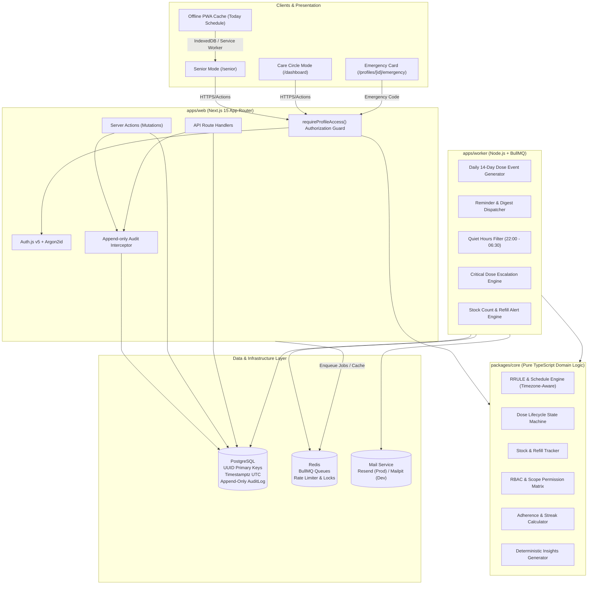
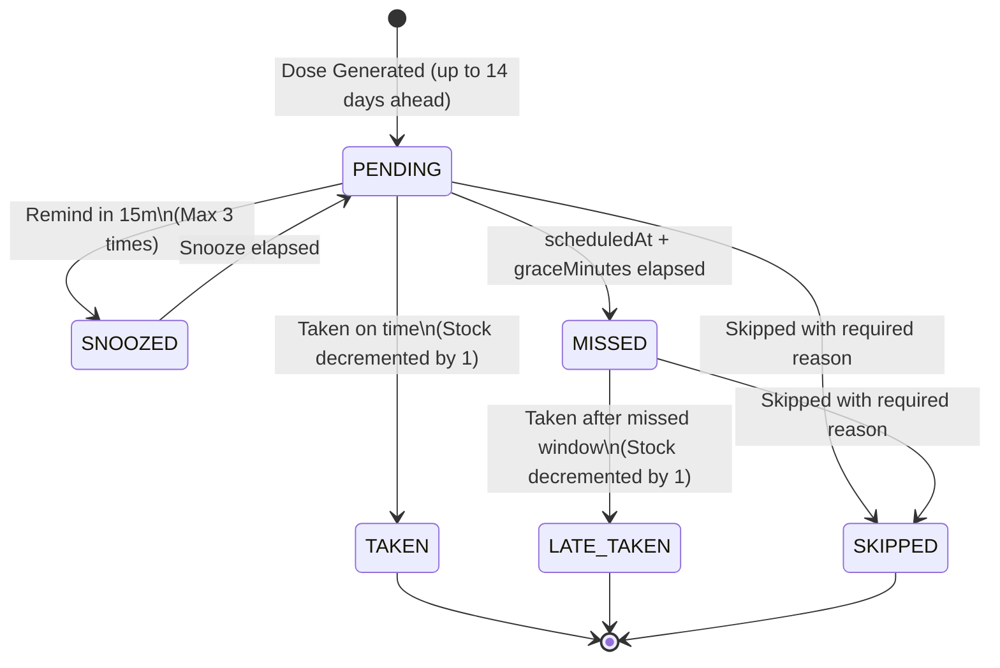
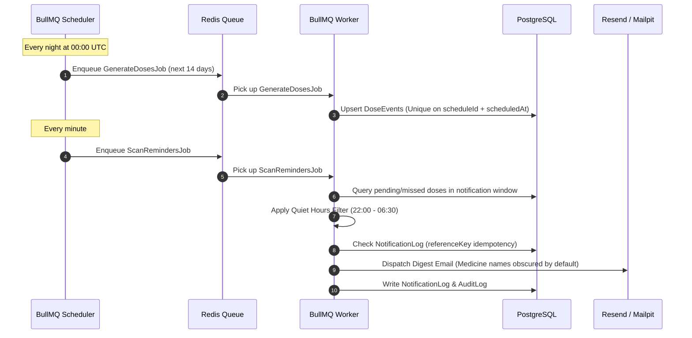

# System Architecture: Elder Care & Medication Management Platform

## 1. System Overview & Component Diagram

The platform uses a modular monorepo structure separating user-facing web experiences, async background processing, shared database access, pure domain logic, UI primitives, and email generation.



---

## 2. Module Boundaries & Workspace Packages

| Package / App | Path | Responsibilities | External I/O? |
|---|---|---|---|
| **apps/web** | `apps/web` | Next.js 15 App Router, UI components, Server Actions, Route Handlers, session cookies, auth flows, speech synthesis integration. | Yes (HTTP, Database, Redis) |
| **apps/worker** | `apps/worker` | BullMQ worker process, cron-like recurring jobs, email notification dispatching, escalation timers, idempotent reference key verification. | Yes (Redis, Database, SMTP/Resend) |
| **packages/db** | `packages/db` | Prisma schema, PostgreSQL migrations, database seed scripts, generated typed Prisma client. | Yes (PostgreSQL) |
| **packages/core** | `packages/core` | Pure domain logic: state machine for dose lifecycle, schedule expansion across DST, stock floor enforcement, permission checks, adherence metrics. | **NO (100% Pure Functions, Zero I/O)** |
| **packages/ui** | `packages/ui` | Accessible shared UI components (Radix primitives, Tailwind CSS tokens for Senior Mode and high contrast). | No |
| **packages/email** | `packages/email` | React Email templates for reminder emails, digests, critical escalations, and caregiver invitations. | No (Render to HTML/text) |
| **docs** | `docs/` | Architecture, PRD, Decisions log, Threat Model, Runbook, Accessibility audits, and API documentation. | No |

---

## 3. Security, Authorization & Session Model

### 3.1 Authentication & Session Management
- **Passwords & Passcodes**: Argon2id via `@node-rs/argon2`.
- **Session Tokens**: Opaque, cryptographically random session IDs stored in PostgreSQL session table. Passed to client as `httpOnly`, `Secure`, `SameSite=Lax` cookies. **Stateless JWTs are prohibited** for authorization to ensure instantaneous session revocation upon user logout, password reset, or security lock.
- **Member Passcode**: 4–6 digit numeric PIN per membership for fast unlock on shared devices. Rate-limited to 5 failures per 15 minutes per membership; locks account on breach.
- **Emergency Code**: An isolated 8-character string unique to the profile, granting read-only access exclusively to `/profiles/[id]/emergency`.

### 3.2 Granular RBAC & Scopes (`requireProfileAccess`)
Access control is enforced by a centralized guard:
```typescript
await requireProfileAccess(profileId, {
  role?: Role,
  scope?: ScopeKey
})
```
- **Roles**:
  - `OWNER`: Full profile control, billing, invitations, deletion, scope modifications.
  - `CAREGIVER`: Manages medications, doses, schedules, appointments, and care notes.
  - `FAMILY`: Read-only adherence timeline, receives missed-dose alerts; no edit rights.
  - `EMERGENCY_VIEWER`: Emergency card access only.
- **Scope Flags**:
  - `view_medications`, `manage_medications`
  - `view_appointments`, `manage_appointments`
  - `view_notes`, `write_notes`
  - `receive_missed_dose_alerts`
  - `view_private_items`
- **Revocation**: Evaluated on **every database query**. No token caching of permissions. Changing a scope or revoking a membership terminates access on the subsequent HTTP request.

---

## 4. Dose Lifecycle State Machine

The dose lifecycle is implemented as a deterministic state machine in `packages/core`:



### Invariants:
1. **Zero Double-Decrement**: Stock count is only decremented upon transitioning to `TAKEN` or `LATE_TAKEN`. Condition: `WHERE stockCount > 0 AND stockDecremented = false`.
2. **Floor at Zero**: Stock count never goes below 0.
3. **Audited Corrections**: Final states (`TAKEN`, `LATE_TAKEN`, `SKIPPED`) can only be modified by an `OWNER` or `CAREGIVER` via an audited correction log.

---

## 5. Background Worker & BullMQ Scheduling

The background worker (`apps/worker`) runs independently of the Next.js web application.



### Worker Resilience & Idempotency:
- **Idempotent Reference Keys**: Every notification generates a deterministic reference key:
  `ref_key = hash(profileId, doseEventId, reminderType, scheduledAt)`
- A unique constraint on `NotificationLog.referenceKey` ensures that worker restarts or repeated executions never dispatch duplicate emails.
- **Quiet Hours**: Between `22:00` and `06:30` (local profile timezone), non-critical dose reminders are deferred until `06:30`. Critical doses (`criticality: CRITICAL`) ignore quiet hours and alert immediately.

---

## 6. Failure Modes & Operational Resilience

| Component / Subsystem | Failure Scenario | Impact | Mitigation Strategy |
|---|---|---|---|
| **PostgreSQL Database** | Primary database connection loss | Web app cannot read/write data | Health check fails; read-only fallback via client PWA cache for today's schedule; automated restart. |
| **Redis** | Redis downtime or queue eviction | Background jobs, rate limits paused | BullMQ persists jobs in Redis RDB/AOF. Next.js falls back to local in-memory rate limiting with safe defaults; alarms trigger via Sentry/Logs. |
| **Email Service (Resend/SMTP)** | Downstream mail delivery failure | Reminder emails delayed | Exponential backoff retry in BullMQ (up to 5 attempts); failures logged in `NotificationLog` with status `FAILED`; critical escalation alerts retry with priority. |
| **Double-Action Race** | Two caregivers tap "Take" at the exact same second | Potential stock double-decrement | Conditional SQL `UPDATE DoseEvent SET status = 'TAKEN' WHERE id = ? AND status = 'PENDING'` ensures only the first succeeds. The second receives `ALREADY_ACTIONED`. |
| **Offline Elder Tablet** | Wi-Fi cuts out in elder's home | Elder cannot access cloud server | Service Worker serves cached `/senior` schedule. Actions queued in local IndexedDB and synchronized once Wi-Fi reconnects. |
